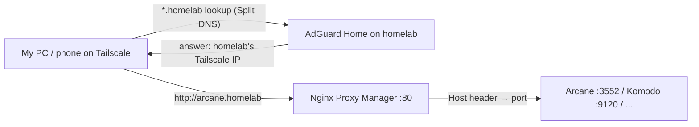

# Always-on desktop and `.homelab` names

**Log #3 · 11 November 2026 (Asia/Dubai)**

Two quality-of-life fixes today:

1. Keep a desktop session running on the GEEKOM all the time, so desktop apps (like OpenMausBot) keep working after I disconnect from RDP.
2. Stop typing `IP:port` for everything. Now `http://arcane.homelab` opens Arcane, from any of my devices on Tailscale, at home or at the office.

> Throughout this log, `<tailscale-ip>` is the homelab's Tailscale address (a `100.x.y.z` IP).

---

## Part 1: An always-on desktop session

### The problem

I'd been using GNOME's **Remote Login** RDP. It creates a *separate* session that dies when I log out, and nothing runs until somebody logs in after a reboot. Desktop-only apps like OpenMausBot (an Electron app with no headless mode) need a real session to live in.

### The fix: auto-login + Desktop Sharing

**1. Auto-login** in `/etc/gdm3/custom.conf`:

```bash
sudo sed -i 's/^#\?\s*AutomaticLoginEnable.*/AutomaticLoginEnable=true/; s/^#\?\s*AutomaticLogin\s*=.*/AutomaticLogin=danish/' /etc/gdm3/custom.conf
grep -i automatic /etc/gdm3/custom.conf
```

**2. A blank keyring password.** With auto-login you never type a password, so the GNOME "Login" keyring stays locked, and Desktop Sharing keeps its RDP password *in that keyring*. Locked keyring = broken RDP after every reboot.

In **Passwords and Keys** (seahorse), right-click the **Login** keyring (not an item inside it!) → **Change Password** → old password → leave the new one empty.

> ⚠️ Gotcha: I first opened the "GNOME Remote Desktop RDP credentials" item and almost hit **Delete Password**. Don't. That's the RDP login itself.

Trade-off: anything saved in the keyring is now stored unencrypted on disk. Fine for a box that lives at home; not something I'd do on a laptop.

**3. Desktop Sharing** (shares the *existing* logged-in session), from a terminal inside the desktop session:

```bash
grdctl rdp enable
grdctl rdp set-credentials <user> '<password>'
grdctl rdp disable-view-only
grdctl status
```

RDP still needs that username and password, and the port is only reachable over Tailscale, so auto-login doesn't open the door to anyone remote.

**4. Reboot and check:**

```bash
ss -tlnp | grep -E '3389|3390'
loginctl list-sessions
```

- `loginctl` showed a `seat0` session on `tty2` for my user, so auto-login worked.
- Remote Login still owns **3389**, so Desktop Sharing negotiated **3390**.
- Connecting to `<tailscale-ip>:3389` failed, because Remote Login can't hand out a session while I'm already logged in locally. **`<tailscale-ip>:3390` works.**

Rule from now on: **close the RDP window, don't log out.**

Optional: lock the screen after a few minutes, since anyone physically at the box lands on my desktop.

### Side note: Parsec-style alternatives

Parsec can't *host* from Linux. The FOSS options I'm keeping in mind:
- **RustDesk**: one app on every OS, self-hostable relay in Docker, can connect directly over Tailscale.
- **Sunshine + Moonlight**: the closest thing to Parsec; low latency, can encode on the GPU (Quick Sync).

Both share the logged-in session, so they'd sit nicely on top of auto-login. Not set up yet.

---

## Part 2: `.homelab` names over Tailscale

### Why not just do AdGuard on the router?

I deferred household DNS (AdGuard on the router) until the homelab is on Ethernet, and my router is finicky. But I didn't need the whole house yet; I needed *my* devices to resolve nice names. Every one of them runs Tailscale anyway.

### The design



1. **AdGuard Home** listens only on the Tailscale IP, with one rewrite: `*.homelab` → `<tailscale-ip>`.
2. **Tailscale Split DNS** sends only `.homelab` lookups to AdGuard; all other DNS is untouched.
3. **Nginx Proxy Manager** maps each hostname to the right port.

Binding to the Tailscale IP sidesteps the classic Ubuntu problem of `systemd-resolved` holding port 53.

### Step 1: AdGuard Home (Arcane project `adguard`)

```yaml
services:
  adguard:
    image: adguard/adguardhome:latest
    container_name: adguard
    restart: unless-stopped
    ports:
      - "<tailscale-ip>:53:53/tcp"
      - "<tailscale-ip>:53:53/udp"
      - "<tailscale-ip>:3000:3000/tcp"   # setup wizard + web UI
    volumes:
      - ./work:/opt/adguardhome/work
      - ./conf:/opt/adguardhome/conf
```

Wizard at `http://<tailscale-ip>:3000`: web UI on all interfaces port 3000 (keeps 80 free for NPM), DNS on all interfaces port 53 (Docker already limits it to the Tailscale IP), admin login.

Then **Filters → DNS rewrites → Add**: `*.homelab` → `<tailscale-ip>`.

Test from Windows:

```
nslookup arcane.homelab <tailscale-ip>
→ Name: arcane.homelab  Address: <tailscale-ip>
```

### Step 2: Tailscale Split DNS

Admin console → **DNS** → **Add nameserver → Custom** → `<tailscale-ip>`, **Restrict to domain** = `homelab`. MagicDNS on.

> Gotcha: plain `nslookup arcane.homelab` on Windows **still fails** ("Non-existent domain") because `nslookup` ignores Tailscale's split DNS and asks the network's normal DNS server directly. Test with `Resolve-DnsName arcane.homelab` or `ping arcane.homelab` instead. Those worked.

**Does the Tailscale IP ever change?** Practically no. It stays fixed while the machine stays in the tailnet. Worth turning on **Disable key expiry** for homelab so it never gets logged out by itself. If it ever did change, there are three places to update: the AdGuard compose, the rewrite, and the Split DNS nameserver.

### Step 3: Nginx Proxy Manager (Arcane project `npm`)

```yaml
services:
  npm:
    image: jc21/nginx-proxy-manager:latest
    container_name: npm
    restart: unless-stopped
    ports:
      - "<tailscale-ip>:80:80"
      - "<tailscale-ip>:443:443"
      - "<tailscale-ip>:81:81"     # admin UI
    extra_hosts:
      - "host.docker.internal:host-gateway"
    volumes:
      - ./data:/data
      - ./letsencrypt:/etc/letsencrypt
```

Proxy hosts (Websockets Support on):

| Hostname | Forward to | Scheme |
|---|---|---|
| `arcane.homelab` | `:3552` | http |
| `komodo.homelab` | `:9120` | http |
| `portainer.homelab` | `:9443` | https |
| `kuma.homelab` | `:3001` | http |
| `beszel.homelab` | `:8090` | http |
| `adguard.homelab` | `<tailscale-ip>:3000` | http |
| `npm.homelab` | `npm:81` (the container itself) | http |

**`host.docker.internal` vs the IP?** Inside the NPM container, `localhost` is the container itself. `host.docker.internal` always points to the host, so it survives IP changes. The Tailscale IP works just as well for anything listening on all interfaces. The exception is AdGuard, which is bound *only* to the Tailscale IP, so that one must use the IP.

Keep `http://<tailscale-ip>:81` as a backdoor. If NPM's config breaks, `npm.homelab` breaks with it.

No real certificates: `.homelab` isn't a public domain, so these are plain `http`. That's fine inside the tailnet.

### The one that didn't work: Cockpit

Cockpit (`:9090`) refused to log in behind NPM:

```json
{ "problem": "authentication-unavailable",
  "message": "Authentication service cannot retrieve authentication info" }
```

What I tried in `/etc/cockpit/cockpit.conf`:
1. `Origins` for the `.homelab` name + `ProtocolHeader = X-Forwarded-Proto` + `AllowUnencrypted = true`. This broke login **even on the direct IP**, because `Origins` *replaces* Cockpit's default list.
2. The same, with the IP origins added back. Still broken on both.
3. Only `Origins` (IP + `.homelab`). Still broken on both.
4. A custom NPM Advanced block (Host, Upgrade, Authorization headers). No change.

Each time, deleting `cockpit.conf` and restarting brought direct login back.

**Workaround: a redirect instead of a proxy.** With no `cockpit.conf` at all, NPM just bounces the browser to Cockpit's real address, so Cockpit never sees a proxy:

NPM → **Hosts → Redirection Hosts → Add**: domain `cockpit.homelab`, scheme `https`, forward domain `<tailscale-ip>:9090`, HTTP code 302, **Preserve Path** on.

Now `http://cockpit.homelab` lands on `https://<tailscale-ip>:9090` and login works like the direct IP (self-signed cert warning included).

> Gotcha: `journalctl -u cockpit` starts at the *oldest* lines. The TLS handshake noise I kept pasting was from the day before (browsers rejecting the self-signed cert). Use `journalctl -u cockpit -e` or `--since "15 min ago"` for current errors.

---

## Limits of this setup

- Only devices running Tailscale resolve `.homelab`. A TV or a guest phone won't, until AdGuard serves the whole LAN (planned once the homelab is on Ethernet).
- If AdGuard or NPM ever fails to come back after a reboot, the likely cause is Docker starting before `tailscale0` has its IP (the ports are bound to it). Not seen yet; fixable with a systemd ordering tweak if it happens.

## Config summary

| Thing | Where |
|---|---|
| Desktop Sharing RDP | `<tailscale-ip>:3390` |
| AdGuard Home UI | `http://adguard.homelab` / `:3000` |
| NPM admin | `http://npm.homelab` / `:81` |
| Arcane | `http://arcane.homelab` / `:3552` |
| Cockpit | `http://cockpit.homelab` (302 redirect to `https://<tailscale-ip>:9090`) |

## Next

- Install OpenMausBot natively (the `.deb` wasn't in `~/Downloads` yet) and add it to autostart.
- Finish OpenBot in Arcane (after the folder ownership fix).
- AdGuard for the whole house once the homelab is on Ethernet.
- Maybe turn off Remote Login so Desktop Sharing gets 3389.
